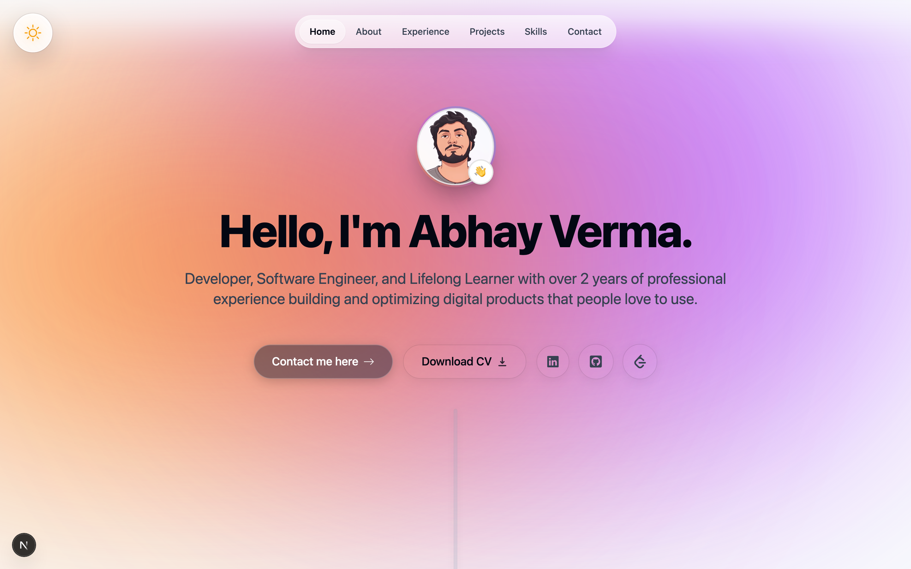
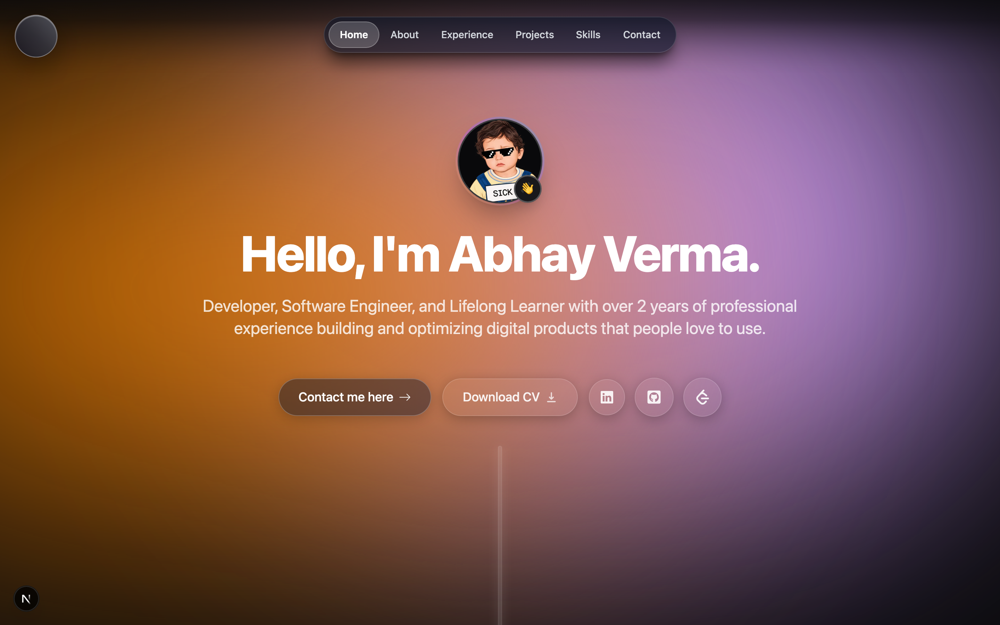
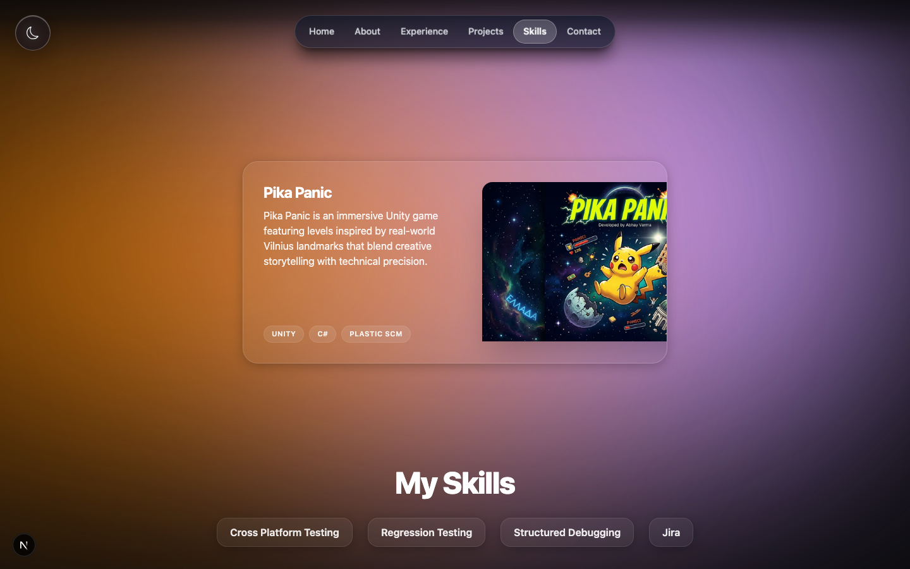
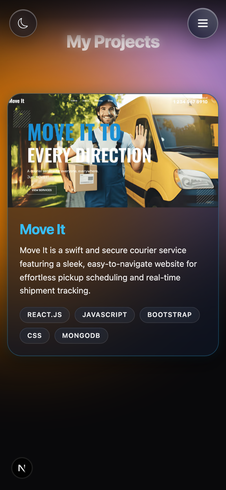
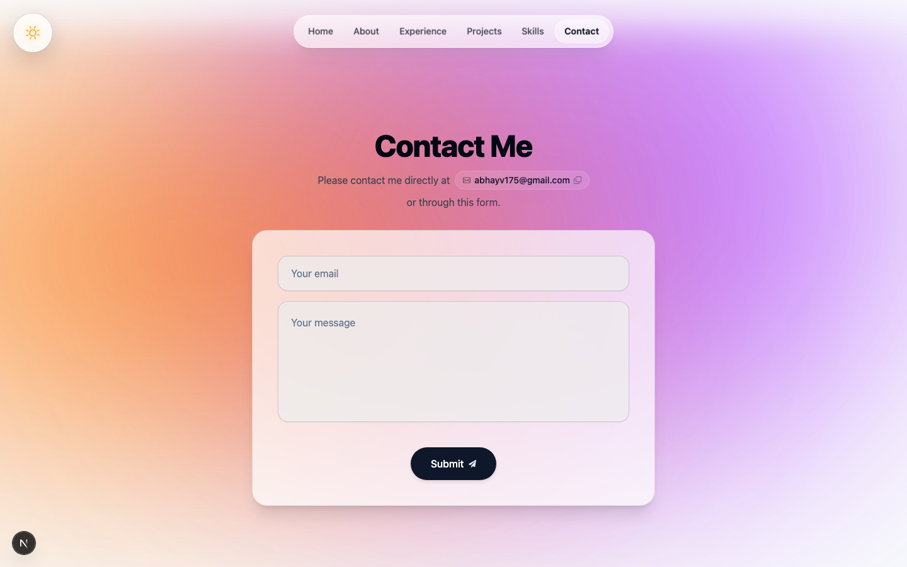
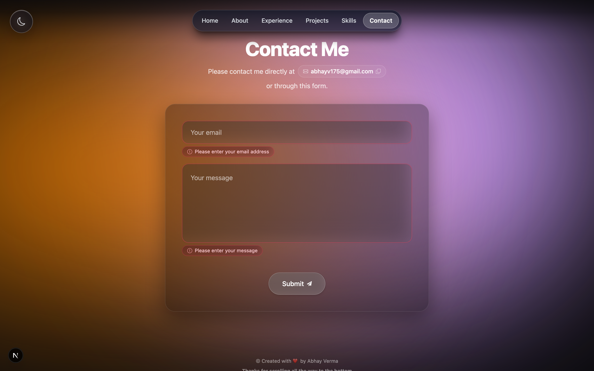
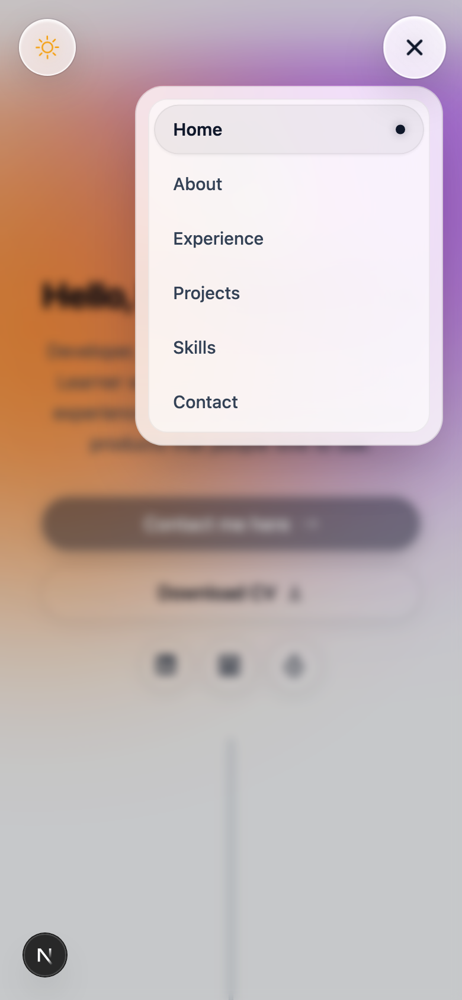
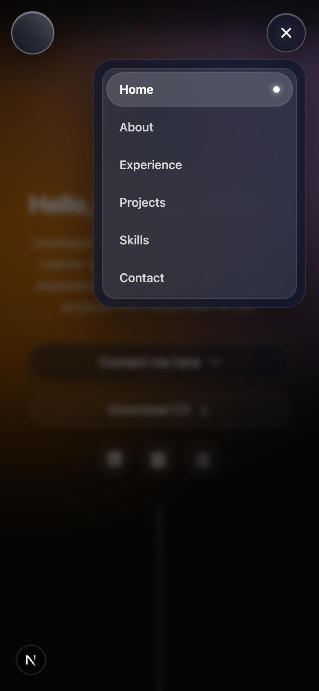

# ✦ Abhay Verma — Personal Portfolio

A modern, high-performance personal portfolio built with **Next.js 15 (App Router)**, **Tailwind CSS**, and **Framer Motion**. Designed around an Apple-inspired **Liquid Glass** aesthetic, featuring specular light highlights, dynamic multi-layer backdrop blurs, organic pill geometry, and 60fps GPU-accelerated micro-interactions.

🌐 **Live Website**: [https://abhayv175.netlify.app](https://abhayv175.netlify.app)

[](https://abhayv175.netlify.app)
[](https://nextjs.org/)
[](https://tailwindcss.com/)
[](https://www.framer.com/motion/)
[](https://www.typescriptlang.org/)

---

## 🎨 Design Aesthetic: Liquid Glass

The portfolio's visual language is built upon Apple VisionOS and macOS liquid glass design principles:
- **Frosted Glassmorphism**: High-blur background diffusion (`backdrop-blur-xl` and `backdrop-blur-2xl`) combined with semi-translucent fills.
- **Specular Highlights & Inner Sheens**: Multi-stop borders (`border-white/20`, `border-black/10`) and radial gradient reflections simulating real-world refraction.
- **Fluid Dynamic Lighting**: Ambient dual-orb glow layers cross-fading smoothly between light mode (`#f8fafc`) and dark mode (`#09090b`).
- **Organic Pill Geometries**: Curved radii (`rounded-full`, `rounded-3xl`) creating a warm, polished, and tactile feel.

---

## 🛠️ Tech Stack Breakdown

| Layer | Technology | Purpose |
| :--- | :--- | :--- |
| **Framework** | [Next.js 15](https://nextjs.org/) | App Router, React Server Components (RSC), Server Actions, and Dynamic Imports |
| **Styling** | [Tailwind CSS 3.4](https://tailwindcss.com/) | Utility-first styling with custom glassmorphism and animation tokens |
| **Animations** | [Framer Motion 11](https://www.framer.com/motion/) | GPU-accelerated spring physics, presence transitions, and layout morphing |
| **Icons** | [React Icons](https://react-icons.github.io/react-icons/) & [Lucide Icons](https://lucide.dev/) | High-resolution scalable vector icons |
| **Email Delivery** | [Resend](https://resend.com/) & [React Email](https://react.email/) | Serverless contact form delivery with responsive HTML email templates |
| **Type Safety** | [TypeScript 5.6](https://www.typescriptlang.org/) | Strict end-to-end type safety across data schemas and component props |
| **Toast Notifications** | [React Hot Toast](https://react-hot-toast.com/) | Specular liquid glass feedback toasts |

---

## ✨ Core Features

### 1. Interactive 3D Hero Avatar
- **Dual-Sided 3D Card**: Smooth 180° Y-axis flip animation between light and dark mode portraits when toggling themes.
- **Dynamic Emoji Reactor**: Clickable interactive emoji badge cycling through custom states (`👋`, `🚀`, `💻`, `⚡`, `🎯`, `🔥`) with bouncy spring physics.
- **Liquid Glass CTA Pills**: High-contrast, tactile download CV and contact buttons with smooth hover scaling and specular shadows.

### 2. Dual-Engine Floating Navigation
- **Desktop Floating Pill**:
  - Centered floating pill with hardware acceleration, `hover:scale-105` zoom, and active section tracking via Framer Motion's shared `layoutId`.
  - Zero-flicker sub-pixel anti-aliasing via dedicated GPU layers.
- **Mobile Menu Drawer**:
  - Isolated morphing 3-line hamburger to close (`X`) toggle button.
  - Compact, pill-shaped floating dropdown (`w-[78%] max-w-[260px]`) anchored neatly below header controls.
  - Theme-adaptive colors (`bg-white/80` in light, `dark:bg-slate-900/80` in dark).
  - Multi-trigger dismissal: backdrop click-away, Escape key listener, and instant nav routing.

### 3. Work Experience Interactive Timeline
- Clean alternating desktop timeline and single-column mobile stack with safe vertical spacing (`space-y-12 sm:space-y-16 md:space-y-24`).
- Rich role history, milestone node icons, and frosted glass cards with interactive hover highlights.

### 4. Smooth 60fps Project Cards
- **Damped Spring Physics**: Tuned with `stiffness: 180, damping: 24, mass: 0.8` for natural presence and expansion without snap-back.
- **Hardware Acceleration**: Card containers locked to the GPU via `transform-gpu will-change-transform backface-hidden [transform-style:preserve-3d]`.
- **Sub-Pixel Edge Locking**: `overflow-hidden rounded-3xl` prevents corner anti-aliasing jitter during hover scale.

### 5. Liquid Glass Contact Form & Validation
- **Accessible Custom Validation**: Replaces native browser tooltips (`noValidate`) with animated liquid glass warning alerts.
- **Focus Illumination**: Fields illuminate with specular outer rings on focus (`focus:ring-2 focus:ring-slate-900/20 dark:focus:ring-white/20`).
- **Server Action Integration**: Direct email submission powered by Resend with optimistic pending spinners and success toasts.
- **Theme-Aware Submit Button**: High-contrast dark fill in light mode (`bg-slate-900 text-white`) and illuminated frosted glass in dark mode (`dark:bg-white/20 dark:backdrop-blur-md`).

### 6. Seamless Viewport Background Coverage
- Root background and ambient glow layers use dynamic viewport units (`min-h-[100dvh] w-full`) and `fixed inset-0 -z-10` to eliminate white bottom gaps on mobile browsers during address bar collapse or iOS rubber-band overscroll.

---

## ⚡ Performance & Optimization Highlights

- **Core Web Vitals**:
  - **Zero Layout Shift (CLS: 0.00)**: Aspect ratio reservation and fixed dimension bounding boxes for all images and interactive cards.
  - **Sub-second LCP**: Next.js `next/image` with `priority={true}`, modern WebP/AVIF compression, and responsive `sizes` attributes.
- **Chromium Re-rasterization Prevention**:
  - Navigation tabs and project cards run on dedicated GPU compositing layers:
    ```css
    transform-gpu will-change-[transform,opacity] backface-hidden [transform-style:preserve-3d]
    ```
- **Sub-Pixel Border Anti-Aliasing**:
  - Clean `outline: 1px solid transparent` applied to floating glass containers stops 1px border vibration during hover state transitions.
- **Code Splitting & Dynamic Imports**:
  - Heavy below-the-fold modules (`About`, `Projects`, `Skills`, `Experience`, `Contact`) are dynamically loaded via `next/dynamic` to ensure lightning-fast initial page loads.

---

## 📸 Screenshots

> Drop your screenshots into the `./public/screenshots/` directory to display them below.

### Hero & Navigation
| Light Mode | Dark Mode |
| :---: | :---: |
|  |  |

### Projects Showcase
| Desktop View | Mobile View |
| :---: | :---: |
|  |  |

### Contact Section & Custom Validation
| Light Mode Form | Dark Mode Alerts |
| :---: | :---: |
|  |  |

### Mobile Pill Navigation Drawer
| Open Drawer (Light) | Open Drawer (Dark) |
| :---: | :---: |
|  |  |

---

## 🚀 Getting Started

### Prerequisites
- **Node.js**: `v18.18+` or `v20+`
- **Package Manager**: `npm`, `pnpm`, or `yarn`

### Installation

1. **Clone the repository**:
   ```bash
   git clone https://github.com/abhayv175/my_portfolio.git
   cd my_portfolio
   ```

2. **Install dependencies**:
   ```bash
   npm install
   ```

3. **Configure Environment Variables**:
   Create a `.env.local` file in the root directory:
   ```env
   RESEND_API_KEY=your_resend_api_key_here
   ```

4. **Run the development server**:
   ```bash
   npm run dev
   ```
   Open [http://localhost:3000](http://localhost:3000) in your browser to view the application.

5. **Build for production**:
   ```bash
   npm run build
   npm run start
   ```

---

## 🌐 Deployment

This portfolio is deployed on [Netlify](https://www.netlify.com/):

🔗 **Live Website**: [https://abhayv175.netlify.app](https://abhayv175.netlify.app)

### Deploying to Netlify
1. Push your code to a GitHub repository.
2. Log into [Netlify](https://app.netlify.com/) and click **Add new site > Import an existing project**.
3. Select your GitHub repository.
4. Netlify will automatically detect Next.js with `@netlify/plugin-nextjs`.
5. Add the `RESEND_API_KEY` environment variable under **Site configuration > Environment variables**.
6. Click **Deploy portfolio**.

---

## 📄 License

This project is open source and available under the [MIT License](LICENSE).
