<div align="center">

# Abhay Verma — Cosmic Portfolio

**Interactive WebGPU Black Hole & White Hole Portfolio Built with Next.js 15, Custom WGSL Shaders, Procedural Web Audio, and Monochrome Glassmorphism**

[](https://abhayv175.netlify.app)
[](https://nextjs.org/)
[](https://www.w3.org/TR/webgpu/)
[](https://www.typescriptlang.org/)
[](https://tailwindcss.com/)
[](https://developer.mozilla.org/en-US/docs/Web/API/Web_Audio_API)

| Dark Mode — Black Hole Singularity | Light Mode — White Hole Inversion |
| :---: | :---: |
| 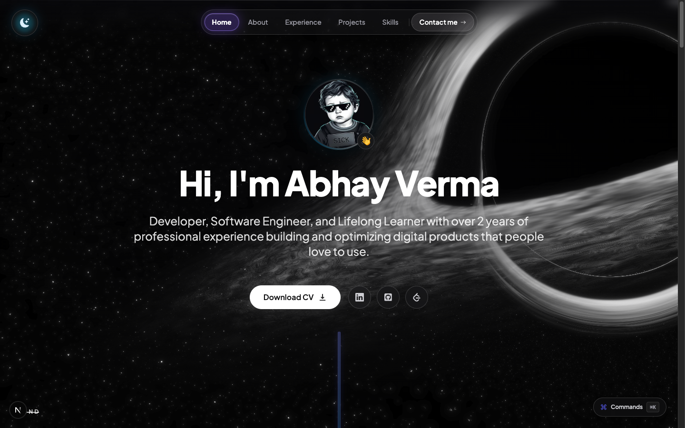 | 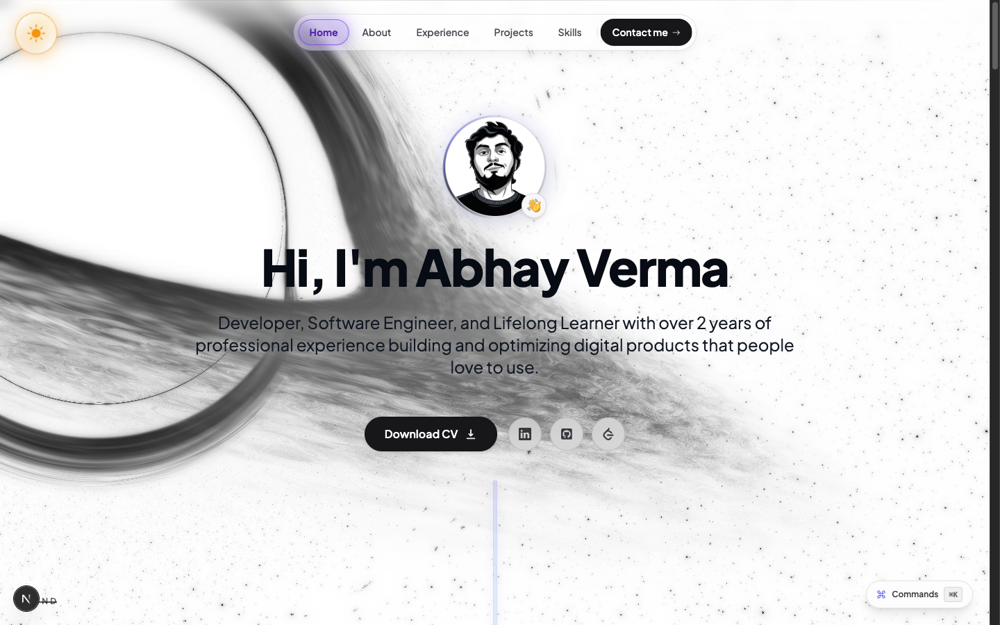 |

</div>

---

## Overview

A personal software engineering and QA portfolio built around a live **60 FPS WebGPU gravitational-lensing simulation** that orbits between a **Black Hole** (Dark Mode) and a mirrored **White Hole** (Light Mode). Every interface layer—from procedural cosmic soundscapes and theme-adaptive favicons to unified translucent glass cards and an opposite-polarity brush cursor trail—is synchronized around the dual-singularity theme.

🌐 **Live Deployment:** [https://abhayv175.netlify.app](https://abhayv175.netlify.app)

---

## Highlights & Features

### 1. Real-Time WebGPU Black Hole ↔ White Hole Engine (`optimized-black-hole/`)
- **Geodesic Ray-Marched G-Buffers:** Integrates Schwarzschild-like relativistic light paths (`MAX_STEPS = 768` in `geodesic.wgsl`) into multi-target HDR textures (`rg32float` / `rgba16float`) across three pre-baked camera poses (`dark`, `mid`, `light`), refined per pixel (`refine.wgsl`).
- **60 FPS Volumetric Shading & Bloom:** Decodes G-buffers each frame (`shade.wgsl`) with 6-tap accretion anti-aliasing, 3D toroidal plasma noise (`noise-volume.mjs`), rotating starfield projection (`stars.wgsl`), 3-level mip bloom (`bloom.wgsl`), ACES filmic tone mapping (`composite.wgsl`), and smooth cursor parallax (`mouseYaw`).
- **1-Second Swirling Orbital Theme Flight:** Toggling Light ↔ Dark launches an `easeInOutCubic` cross-viewport flight (`right ↔ left`) with mid-flight vortex swirl (`morph.wgsl`), gravitational wavefront color inversion (`composite.wgsl`), vsync-locked frame pacing (`renderer.ts`), and a non-blocking `320ms` DOM midpoint crossfade (`theme-context.tsx`).
- **Graceful Progressive Fallback:** Automatically renders multi-orb Framer Motion ambient lighting (`components/ambient-glow.tsx`) on browsers without WebGPU or when `prefers-reduced-motion` is enabled.

### 2. Motion-Reactive Procedural Space Audio & Minimal `SOUND` Control
- **Deep-Space Black Hole Synthesis (`lib/space-audio.ts`):** Pure Web Audio API synthesis requiring **zero audio file downloads**—combining a `D1 / A1 / D2` sub-gravity foundation, slow phase-beating pressure waves, `F3` void choir tones, Brownian cosmos turbulence sculpted through high-`Q` harmonic corona resonators (`146.8Hz`, `220Hz`, `349.2Hz`), and a **5.4-second** stereo cosmos convolution reverb (`ConvolverNode`).
- **Kinetic Velocity Coupling:** Tracks real-time black-hole camera yaw velocity, theme-flight gravitational surges, and scroll speed (`context/sound-context.tsx`) without causing React re-renders—staying calm and low at rest while blooming deeper and wider as the hole accelerates.
- **Directional Theme-Switch Audio:** Plays distinct horizon sound sweeps every time the theme switches while sound is enabled (inward singularity collapse for Light → Dark; outward crystalline corona bloom for Dark → Light).
- **Minimal Bottom-Left Toggle (`components/sound-toggle.tsx`):** Starts **muted by default** (`~~SOUND~~` with animated strikethrough) using bare monochrome tracked typography to respect browser autoplay policies and stay visually unobtrusive.

### 3. Editorial Monochrome Hero & Opposite-Hole Cursor Ribbon
- **Dual-Portrait 3D Avatar Flip (`components/intro.tsx`):** Pairs custom monochrome portraits—childhood (`hero_dark.png`) in Dark Mode and current adult (`hero_light.png`) in Light Mode—inside a rotating orbital photon-ring halo with click-to-flip 3D perspective physics and an interactive emoji cycle badge.
- **Opposite-Singularity Brush Ribbon (`components/red-ribbon.tsx`):** Hardware-friendly 2D Canvas trail using `getCoalescedEvents()` and C¹ midpoint quadratic Bézier splines—painting Luminous White Hole mist in Dark Mode and Obsidian Black Hole ink with silver photon streaks in Light Mode.
- **Staggered Smooth Load Choreography:** Orchestrated `~1.4s` WebGPU reveal paired with zero-reflow typed headline text, slide-in header, and fade-in hero actions.

### 4. Unified Glassmorphism System (`components/surface-styles.ts`)
- Centralized design tokens synchronize surface translucency, borders, and backdrop blur symmetrically across **all sections and both themes**:
  - **Section Cards** (`Experience`, `Projects`, `Skills`, `Contact`): `45%` rest → `65%` hover → `75%` mobile scroll focus → `85%` cross-highlight (`12px` mobile / `24px` desktop blur).
  - **Floating Controls & Nav Pills** (`Header` desktop & mobile hamburger pill menu, `ThemeSwitch`, `Commands`, Intro social links, Contact copy pill): `45%` rest → `65%` hover (`24px` blur).
  - **Nested Panels, Tags & Inputs**: `5%` rest → `10%` interactive hover (`bg-black/5 dark:bg-white/5`).
  - **Modals** (`Experience` & `CommandPalette`): `85%` fill (`backdrop-blur-2xl`) over unified translucent backdrops.

### 5. Interactive Sections & Productivity Controls
- **Horizontal Projects Rail (`components/projects.tsx`):** Scroll-driven sticky horizontal track on desktop with Lenis smooth-scroll quick-jump pills (`01 · PrintPulse` through `05 · Banking`) and center-focus stacked layout on mobile:
  - *PrintPulse:* Interactive 3-stage packet-flow simulator (`Customer Web Portal` → `Direct UPI Settlement` → `Vendor Android Tablet`) with live screenshot switching.
  - *Passenger Text:* Hover/scroll-reactive real-time chat preview.
  - *Pika Panic:* Unity 3D Vilnius level artwork showcase.
  - *Move It:* Cursor-tracking radial spotlight hover card.
  - *Banking Application:* Interactive simulated balance & quick-deposit preview.
- **Work Experience Timeline & Portaled Modals (`components/experience.tsx`):** Color-coded staggered timeline (`Marquistech`, `Unity`, `UAB First Riddle`, `Infowiz`) expanding into centered keyboard-dismissible (`Esc`) frosted glass modals.
- **Cross-Highlighting Skills Grid (`components/skills.tsx`):** Hovering or focusing *Frontend & Mobile*, *Backend & Cloud Architecture*, or *QA, Modem Testing & Game Dev* highlights matching apps inside the Projects rail via custom browser events.
- **Command Palette (`⌘K` / `/`) (`components/command-palette.tsx`):** Instant fuzzy launcher to jump sections, copy email, download CV, toggle Dark/Light theme, mute/enable space audio, filter & scroll directly to projects by tech stack, and open external profiles.
- **Theme-Synced Favicons (`app/layout.tsx`, `public/favicon-*.svg`):** Multi-size Black Hole `favicon.ico` (`16/32/48px`), `180x180` `apple-icon.png`, and runtime-swapped Dark/Light SVG tab icons synchronized before first paint and on every theme toggle.
- **Protected Contact Form (`components/contact.tsx`, `actions/sendEmail.ts`):** Custom inline validation badges, click-to-copy email pill, honeypot spam trap, and HTML email templates sent via Resend + React Email.

---

## Visual Showcase

### Command Palette (`⌘K` / `/`) & Responsive Mobile Views
| Interactive Command Palette | Mobile Hero (Dark Mode) | Mobile Pill Nav (Dark) | Mobile Pill Nav (Light) |
| :---: | :---: | :---: | :---: |
| 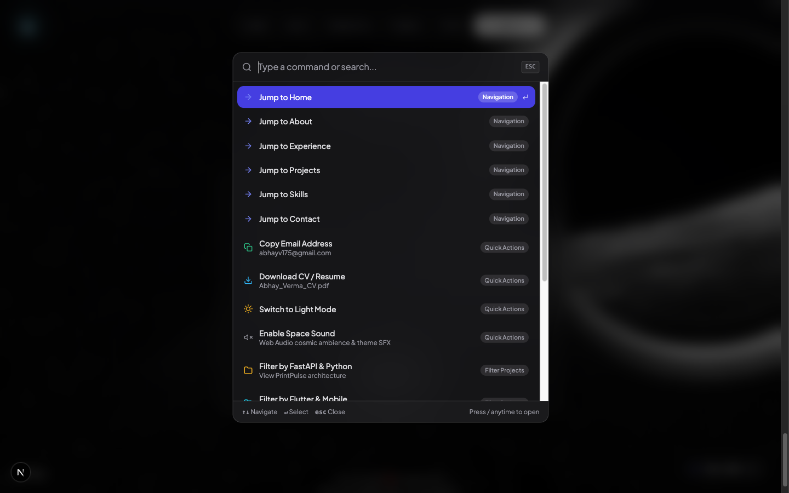 | 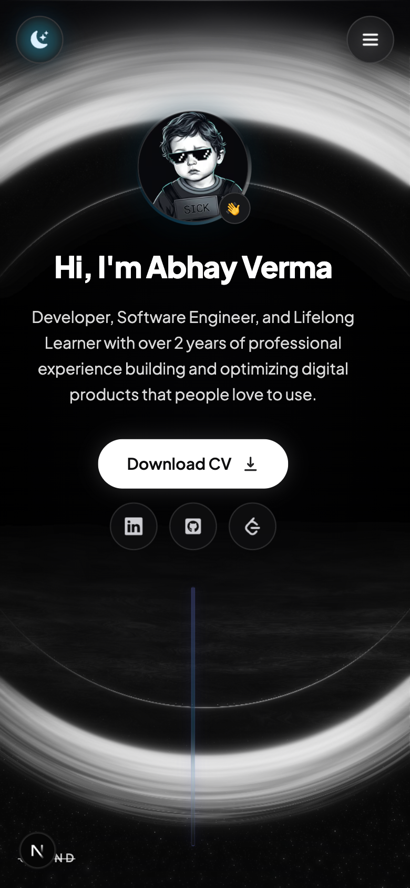 | 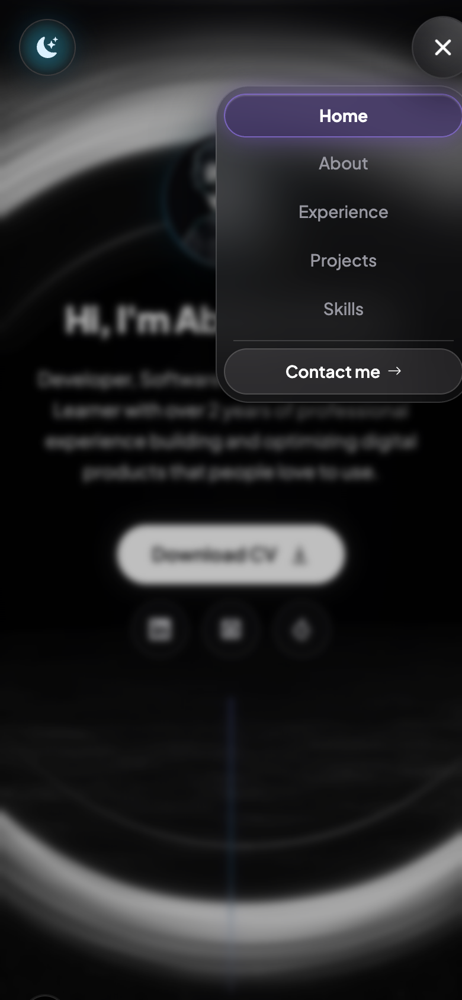 | 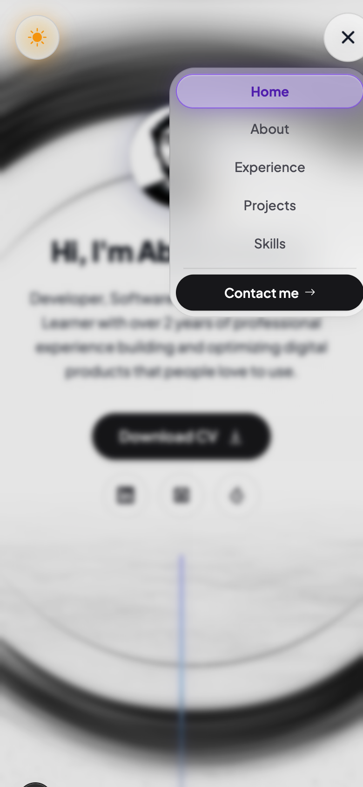 |

### Projects Horizontal Rail & Interactive Skills Domains
| Desktop Projects Rail (`PrintPulse` Simulator + `Passenger Text`) | Cross-Highlighting Skills Domain Grid |
| :---: | :---: |
| 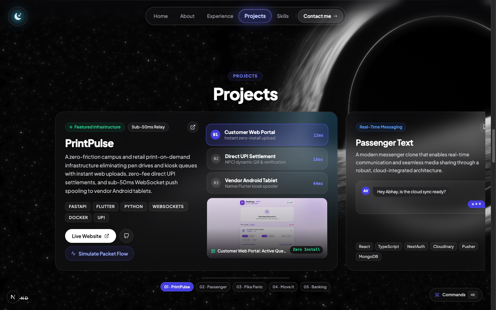 | 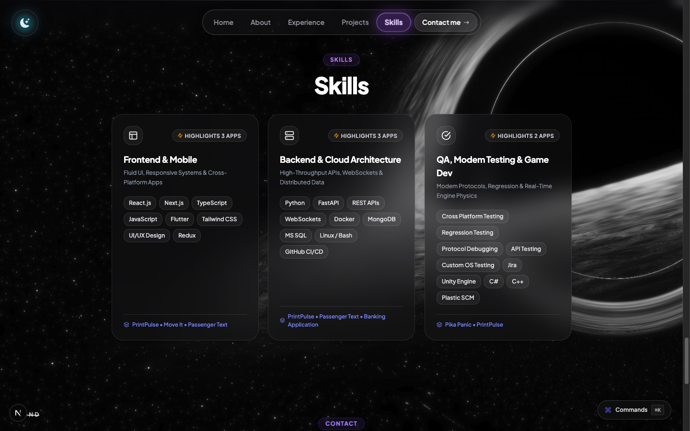 |

### Staggered Experience Timeline & Expanded Detail Modal
| Color-Coded Glass Timeline | Portaled Experience Detail Dialog |
| :---: | :---: |
| 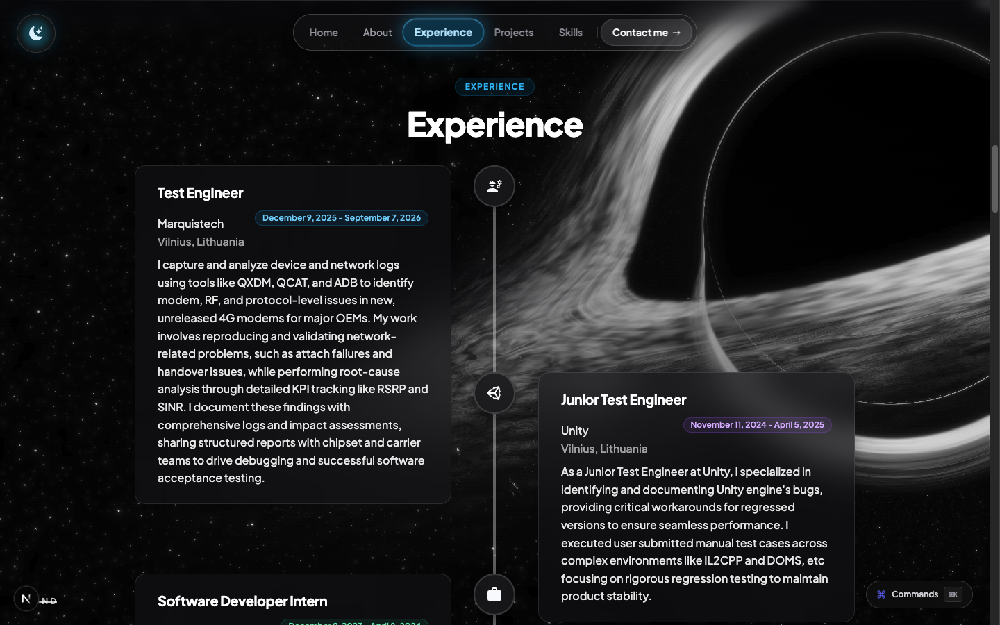 | 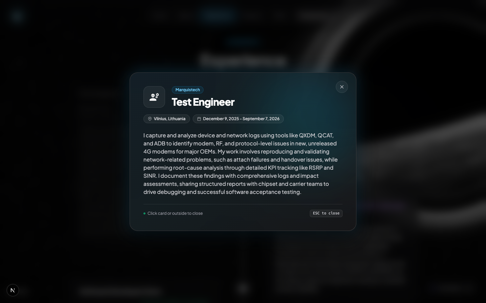 |

### Contact Section & Unified Glass Surfaces (Light ↔ Dark)
| Dark Mode Contact Card | Light Mode Contact Card |
| :---: | :---: |
| 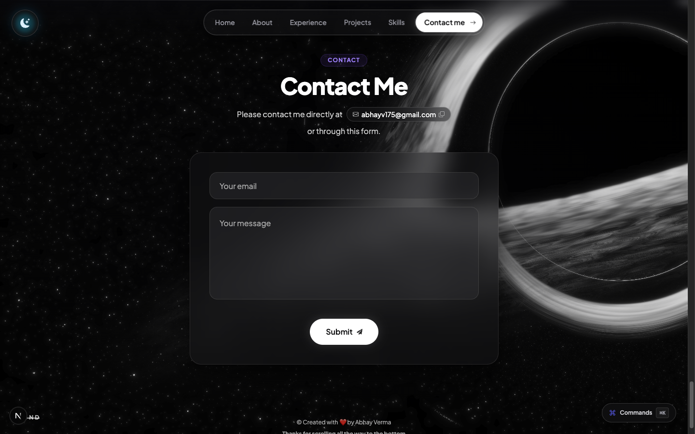 | 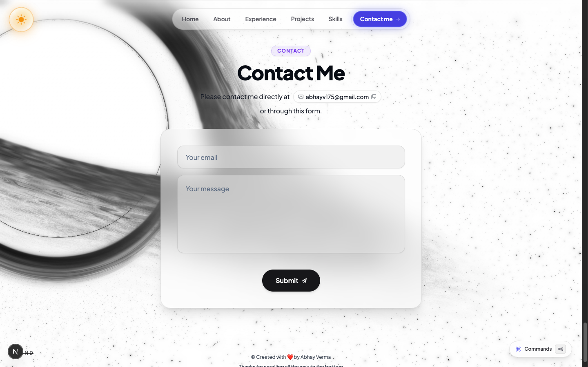 |

---

## Tech Stack

| Layer | Technologies | Usage |
| :--- | :--- | :--- |
| **Framework & Runtime** | **Next.js 15** (`^15.1.5`), **React 18.3**, **TypeScript 5.6** | App Router, Server Actions, static metadata routes (`sitemap.ts`, `robots.ts`), dynamic layout |
| **WebGPU & Shaders** | **vgpu** (`^0.6.0`), **@vgpu/wgsl** (`^0.6.0`), Custom **WGSL** | Multi-pass G-buffer raymarching, bloom, vortex morph, composite tone mapping |
| **Spatial Audio** | **Web Audio API** (`AudioContext`, `ConvolverNode`, `BiquadFilterNode`) | Motion-reactive cosmos ambience, 5.4s void reverb, directional theme-switch SFX |
| **Styling & Fonts** | **Tailwind CSS 3.4**, **Plus Jakarta Sans** (`next/font/google`), **clsx** | Monochrome glassmorphism (`surface-styles.ts`), smooth CSS theme waves |
| **Animation & Scroll** | **Framer Motion 11**, **Lenis** (`^1.3.27`), **Intersection Observer** | Spring physics, 3D portrait flip, horizontal sticky scroll rail, mobile focus tracking |
| **Email & Feedback** | **Resend** (`^4.1.1`), **React Email**, **React Hot Toast** | Serverless contact form delivery with styled HTML emails and toast alerts |
| **Icons & UI Widgets** | **React Icons** (`^5.4.0`), **react-vertical-timeline-component** | Section iconography and responsive alternating work history timeline |

---

## Project Structure

```text
├── actions/
│   └── sendEmail.ts                 # Resend Server Action with validation & honeypot check
├── app/
│   ├── apple-icon.png               # 180x180 monochrome Black Hole Apple touch icon
│   ├── favicon.ico                  # Multi-size (16/32/48) Black Hole fallback favicon
│   ├── globals.css                  # Tailwind layers, glass blur rules, entrance & theme wave animations
│   ├── layout.tsx                   # Root metadata, pre-paint theme/favicon sync, global providers
│   ├── page.tsx                     # Single-page section composition
│   ├── robots.ts / sitemap.ts       # Automated SEO crawler configuration
├── components/
│   ├── surface-styles.ts            # Unified Light/Dark glass translucency tokens
│   ├── black-hole-background.tsx    # WebGPU canvas mount, lifecycle & audio velocity hook
│   ├── ambient-glow.tsx             # Adaptive backdrop wrapper + non-WebGPU gradient fallback
│   ├── red-ribbon.tsx               # Opposite-theme C1 Bézier pointer ribbon canvas
│   ├── sound-toggle.tsx             # Minimal bottom-left SOUND / strikethrough toggle
│   ├── command-palette.tsx          # Keyboard launcher (⌘K / /) for navigation & actions
│   ├── header.tsx / theme-switch.tsx
│   ├── intro.tsx / about.tsx / section-divider.tsx / section-heading.tsx
│   ├── experience.tsx / projects.tsx / skills.tsx / contact.tsx / footer.tsx
│   └── smooth-scroll.tsx / magnetic.tsx / submit-btn.tsx
├── context/
│   ├── sound-context.tsx            # Mute state + scroll/fallback motion telemetry
│   ├── theme-context.tsx            # Dark/Light orchestration, WebGPU midpoint delay & tab favicon sync
│   └── active-section-context.tsx   # Active section & scroll-spy lock state
├── email/
│   └── contact-form-email.tsx       # React Email message layout
├── lib/
│   ├── space-audio.ts               # Procedural black-hole Web Audio engine & 5.4s reverb
│   ├── data.ts / hooks.ts / types.ts / utils.ts
├── optimized-black-hole/            # WebGPU renderer, pipeline & 10 custom WGSL shaders
│   ├── renderer.ts / pipeline.ts / settings.ts / noise-volume.mjs
│   └── *.wgsl                       # bake, refine, geodesic, gbuffer, disk, stars, shade, morph, bloom, composite
├── docs/screenshots/                # Live desktop & mobile screenshots for README
└── public/                          # Portraits, project previews, CV.pdf, favicon-dark/light SVGs
```

---

## Getting Started

### Prerequisites
- **Node.js** `18.18+` or `20+`
- **npm** (or `pnpm` / `yarn`)
- Modern WebGPU-capable browser (Chrome 113+, Edge 113+, Safari 26+/Technology Preview) for the live GPU simulation; non-WebGPU browsers gracefully receive the animated ambient gradient fallback.

### Local Development

1. **Clone the repository**
   ```bash
   git clone https://github.com/abhayv175/my_portfolio.git
   cd my_portfolio
   ```

2. **Install dependencies**
   ```bash
   npm install
   ```

3. **Configure environment variables**
   Create `.env.local` in the project root to enable the contact form server action:
   ```env
   RESEND_API_KEY=your_resend_api_key_here
   ```

4. **Start the development server**
   ```bash
   npm run dev
   ```
   Open [http://localhost:3000](http://localhost:3000) in your browser.

5. **Type-check and build for production**
   ```bash
   npx tsc --noEmit
   npm run build
   npm run start
   ```

---

## Deployment

Deployed on **[Netlify](https://www.netlify.com/)** at [https://abhayv175.netlify.app](https://abhayv175.netlify.app):
1. Import the repository into Netlify (detected automatically as Next.js with `@netlify/plugin-nextjs`).
2. Add `RESEND_API_KEY` under **Site configuration → Environment variables**.
3. Trigger deploy.
